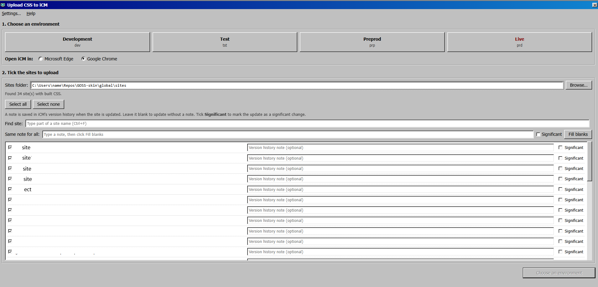
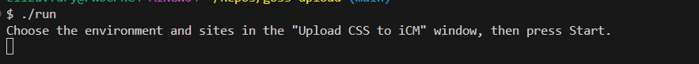

# GOSS Automation Upload — CSS upload tool for the GOSS Digital Platform (iCM)



An automation tool for the **GOSS Digital Platform** that bulk-uploads site CSS to
**GOSS iCM** Media. It saves you opening every site's CSS item in iCM and uploading the
file by hand — pick an environment and your sites in a small window, log in to iCM
yourself, and it does the rest with [Playwright](https://playwright.dev) driving
Microsoft Edge or Google Chrome.

Built for teams running GOSS iCM / GOSS CMS (local government, councils, NHS, public
sector) who maintain multi-site skins in a GOSS-skin project.

**What it does:** uploads each site's compiled CSS from `GOSS-skin/global/sites` to GOSS
iCM Media, across dev, test, preprod and live, with version-history notes and
"significant change" support.

> Unofficial, community-made tool. Not affiliated with or endorsed by GOSS Interactive.
> "GOSS", "GOSS Digital Platform" and "iCM" are names of GOSS Interactive's products,
> used here only to describe what this tool works with.

## Folder layout

```
Repos/
  GOSS-skin/
    global/sites/<site>/<site>.css   built CSS, one folder per site
  goss-upload/
    upload-css.js        does the uploading in iCM
    build-exe.js         builds Upload CSS.exe (optional)
    picker/              the "Upload CSS to iCM" window
      picker.html          the layout
      picker.css           the old-Windows look
      picker.js            how it behaves (buttons, search, Browse…)
      preview.js           pretend data, for opening picker.html on its own
    report/              the failure picture's layout (failure-report.html/.css)
    screenshots/         failure pictures are saved here (made when needed)
    .env                 your settings (not shared)
    package.json
```

## Two ways to run it

- **In the terminal** — needs Node.js. Nothing to approve. Best for the people who
  build the CSS.
- **As `Upload CSS.exe`** — no Node.js needed, just double-click. But the .exe has to
  be approved by IT first (see that section).

Either way, you need **Microsoft Edge or Google Chrome** installed.

---

## Setup A: run it in the terminal

### Once

1. Install **Node.js 20 or newer** (from nodejs.org, or your software centre).
2. Get this folder: either
   - `git clone https://github.com/Efury1/GOSS_AUTOMATION_UPLOAD.git`, or
   - on GitHub, **Code › Download ZIP**, then unzip it.
   Put it next to `GOSS-skin` (e.g. both inside `Repos`).
3. In the `goss-upload` folder, run:
   ```
   npm install
   ```
4. (Optional) Make a desktop shortcut so you don't need the terminal each time:
   1. In cmd, type `where node` and note the path (usually
      `C:\Program Files\nodejs\node.exe`).
   2. Right-click the desktop › **New › Shortcut**.
   3. Paste, with your own node path and folder:
      ```
      "C:\Program Files\nodejs\node.exe" "C:\Users\<your-username>\Repos\goss-upload\upload-css.js"
      ```
   4. **Next**, name it **Upload CSS**, **Finish**.
   5. Right-click it › **Properties** › set **Start in** to your `goss-upload`
      folder, so the failure pictures save there. **OK**.

### Every time

1. Build the CSS in GOSS-skin.
2. Start it: double-click the **Upload CSS** shortcut, or in the `goss-upload` folder
   run `npm start`.
3. **The first time**, a **Settings** box asks for your sites folder, iCM links and
   browser, and saves them in `.env`. Change them later from **Settings…** in the
   window's menu.
4. In the window: pick an environment and browser, tick the sites, press **Start**.
   Live (prd) needs a second click to confirm.
5. Log in to iCM. It handles the "already logged on" warning and the security
   questions note, then starts by itself.
6. Leave the browser alone while it works. The black window shows OK or FAIL per site.
   When it's done, press Enter there to close.

### Straight from the terminal (no window)



| Command | What it does |
|---|---|
| `npm start` | Opens the window |
| `npm run upload:dev -- all` | Every site to dev, no window |
| `npm run upload:prp -- example-site` | One site to preprod, no window |
| `npm run upload:prd -- all` | Every site to live (asks you to confirm) |

Add `--note "text"`, `--significant` or `--browser chrome` to any of these.

---

## Setup B: run it as Upload CSS.exe

With the .exe, people don't need Node.js or any commands: they just double-click it.

> **You must get it approved by IT first.** The .exe isn't signed, so Windows (or your
> organisation's policy) will likely block it with "Windows protected your PC" or
> "Contact your system administrator". Ask IT to allow it, sign it, or add it to the
> software centre. Don't try to get around the block. Until it's approved, use
> **Setup A** instead — that runs the Node.js IT already allows.

### Build it (once, by you)

On a Windows PC with Node.js, in the `goss-upload` folder:

```
npm install
npm run build-exe
```

That makes `dist\Upload CSS\`, with `Upload CSS.exe` and everything beside it
(`picker`, `report`, Playwright in `node_modules`, `.env.example`, this README).
Zip the whole `Upload CSS` folder to hand out. Rebuild after changing
`upload-css.js`; changes to the `picker` or `report` files just need copying in.

### Use it (once IT has approved it)

1. Unzip the `Upload CSS` folder anywhere, e.g. Documents.
2. Double-click **Upload CSS.exe**. The first time, the Settings box asks for the
   sites folder, iCM links and browser, and saves `.env` next to the .exe.
3. (Optional) Right-click it › **Send to › Desktop (create shortcut)**.

---

## Settings (.env)

All settings live in the `.env` file in the goss-upload folder. The easiest way to
change them is **Settings…** in the window's menu. `.env` is never shared (it's in
`.gitignore`), so your links and folder stay on your own PC.

- **SITES_DIR** — the folder holding one folder per site. A full path, or relative to
  goss-upload.
- **ICM_…_URL** — the iCM login page for each environment (dev, tst, prp, prd).
- **BROWSER** — `msedge` or `chrome`. Optional: leave it out to pick in the window.
- **LEARN_MODE** — `true` uploads the first ticked site only and saves extra pictures,
  for testing. Normally `false`.

## If a site fails

- A picture is saved in `goss-upload\screenshots`, named with the date, time and site,
  e.g. `2026-10-30 14-05-09 FAILED example-site.png`. The top says what went wrong and
  at which step; underneath is what the browser was showing. If the whole run stops
  (e.g. login), the picture is named `... FAILED run.png`.
- **"No CSS item in iCM matches"**: the iCM name is too different from the folder name.
  Add it to `ALIASES` in `upload-css.js`, e.g. `{ 'short-name': 'Full Name In iCM' }`.

## Reporting a problem

Open an issue at https://github.com/Efury1/GOSS_AUTOMATION_UPLOAD/issues — include
what you were doing, what happened, the failure picture, and the text from the black
window. Don't include passwords or anything private.

## Changing the window

The window is ordinary web files in the `picker` folder. To see a change without
running an upload, open `picker/picker.html` straight in a browser: it uses pretend
sites and folders from `preview.js`, and Start just shows what it would send.

---

### About / keywords

GOSS Digital Platform · GOSS iCM · GOSS CMS · GOSS Interactive · iCM Media Library ·
CSS upload automation · bulk upload CSS to iCM · GOSS-skin · subsite skin · multi-site
CMS · public sector / local government / council / NHS digital platform · Playwright
browser automation · Node.js. This is a GOSS platform automation tool for uploading
stylesheets to iCM.